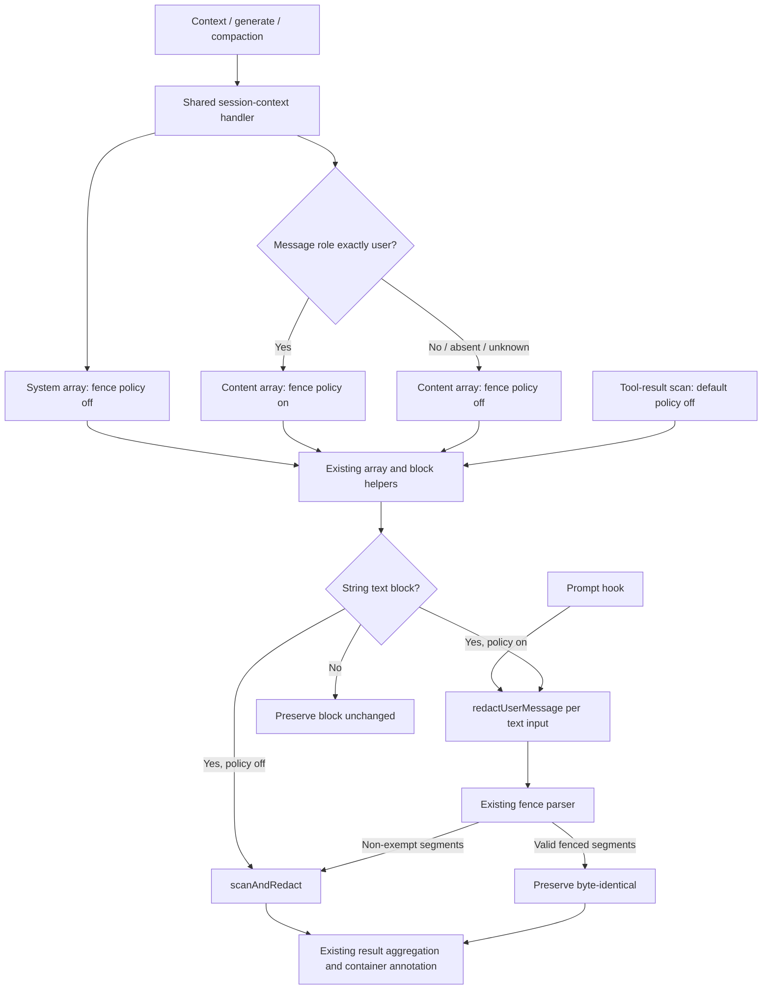

# Design

## Context

V2 has two distinct boundaries: `prompt` redacts composer input before admission, while `context`, `generate`, and `compaction` scan assembled request text. The latter three share `redactSessionContextHandler`, `redactTextBlockArray`, and `redactContentBlock` in `src/plugin.v2.js`. The block helper is also used by tool-result scanning, so changing its default would expand the exemption beyond this change.

The existing contracts in `request-payload-redaction`, `user-message-redaction`, and `tool-output-redaction` require request scanning, the deliberate user-message fence exemption, and fence-unaware tool scanning respectively. This change adds the missing request-stage user-role exception; it does not weaken scanning for all message history.

### Confirmed constraints

- The proposal records the user's acceptance of a **role-based**, not human-authorship-based, exemption (confirmed to the commissioning session as “1 is fine” on 2026-10-15 at 14:53:43).
- Research supplied by the commissioning session verified installed `@opencode/plugin` and `@opencode/ai` 2.0.12: message roles are `system`, `user`, `assistant`, and `tool`; text parts expose `type`, `text`, `cache`, `metadata`, and `providerMetadata`, with no standard synthetic/origin flag.
- That research also verified that synthetic text, expanded files, and compaction summaries can become user-role text. They receive the exemption when they contain a valid fence. Role is not an assertion of trusted provenance.
- Preserve scanner-error fail-open behavior, annotation aggregation, non-text handling, V1 behavior, and existing tool protection. No dependencies, metadata, configuration, or public API are added.
- Work is local to the existing hooks and request payload sizes; no new service, storage, concurrency model, or throughput target is introduced. Retain the current scanning resource profile rather than promising a new latency bound.

## Diagnosis

**Confirmed from source:** the prompt hook calls annotation-free `redactUserMessage`, which uses `splitNoRedactSegments` and scans only non-exempt segments. Request-stage `redactContentBlock` instead always calls `scanAndRedact`, without inspecting the containing message role. Thus a subsequent assembled user message loses the exemption even though its fence delimiters remain present.

The commissioning session reproduced this with the known-detectable AWS fixture: `prompt` preserves the fenced fixture, but each of `context`, `generate`, and `compaction` redacts it. This design relies on that supplied reproduction; no tests were executed during design. Synthetic EKS URL detection was not reproduced and is not evidence for this diagnosis.

## Goals / Non-Goals

**Goals:** preserve valid fences through every supported request-stage scan of user-role text, including repeated scans; continue scanning surrounding text and invalid fences; keep every other role and system/tool path fence-unaware.

**Non-goals:** infer human authorship, track provenance, recover previously redacted values, change fence grammar or detection rules, reconcile annotation wording, scan additional content variants, or extend hook coverage beyond existing registrations.

## Decisions

### D1 — Select the exemption at the message boundary

Two boundaries were considered:

| Option | Trade-offs |
| --- | --- |
| Strict user-role selection | Uses an existing verified field, is stateless and survives re-derived history. It also exempts synthetic or expanded text represented as user-role; the user explicitly accepted this consequence. |
| Provenance-aware selection | Could distinguish composer input from other user-role content, but the verified text-part shape supplies no standard provenance flag. It would require tracking, propagation, and lifecycle rules outside the accepted scope. |

**Recommendation:** strict `message.role === "user"` selection in `redactSessionContextHandler`. No truthiness, case normalization, role inference, or metadata heuristic. Missing and unknown roles remain on normal scanning. `event.system` never opts in, regardless of any extra fields on its elements.

### D2 — Reuse the existing block pipeline with a default-off policy

Two viable internal structures satisfy D1:

| Option | Resilience, maintenance, simplicity, and cost |
| --- | --- |
| Add a private default-off fence policy to the existing array/block helper options | Keeps one block guard, reconstruction path, and annotation aggregator. Only message-history calls explicitly opt in; system and tool callers retain their existing default. Smallest change, with a security-sensitive default that tests must protect. |
| Add a dedicated user-role array/block processing path | Makes the exemption explicit at a separate entrypoint, but duplicates traversal/aggregation or introduces another helper abstraction solely for this distinction. More opportunities for annotation and non-text behavior to drift. |

**Recommendation:** the default-off policy in the existing helpers. Carry that private choice from the message call through `redactTextBlockArray` into `redactContentBlock`; keep all generic callers fence-unaware when the option is omitted. For opted-in text blocks, call the existing annotation-free `redactUserMessage`; otherwise call `scanAndRedact`. Their common `{ text, redactionCount, ruleIds }` result allows the existing block and container logic to remain intact.

The block guard still accepts only `type === "text"` with string `text`. Preserve other block properties when replacing text. No changes to `redact.js` are needed: its parser is a text policy mechanism, while its caller decides eligibility. Its user-authorship commentary must not be treated as provenance enforcement.

### D3 — Parse each block independently; retain aggregation

Invoke `redactUserMessage` separately for each eligible text block. Never join blocks or messages before parsing. Each invocation starts with no open fence; an unmatched opener at the end of one block cannot exempt another block or message. Reuse the parser's exact existing grammar, including equal-length closing backticks, ASCII case-insensitive `noredact`, indentation constraints, and byte-preserving delimiter handling.

The alternative—joining a container and mapping ranges back—would allow cross-block fences or require additional boundary bookkeeping. It is unnecessary and conflicts with the accepted per-block boundary.

Keep `redactTextBlockArray`'s aggregate-then-annotate behavior: count only actual replacements, union and sort rule identifiers, and append one existing `buildAnnotation` note to the last redacted block per container. Exempt-only or clean containers produce no new note. Do not append `buildUserMessageAnnotation` per block; the prompt hook keeps its own existing annotation behavior. Request-stage wording remains unchanged despite its tool-output terminology.

### YAGNI gate

- Reject provenance maps and synthetic-content heuristics: the accepted policy is role-based and there is no standard source flag to consume.
- Reject a new parser or Markdown dependency: the existing fence parser already defines the required grammar.
- Reject persisted exemption markers, caches, and message mutation tags: rescanning the current block is sufficient and avoids lifecycle/state invalidation problems.
- Reject global fence awareness in `scanAndRedact`: it would exempt system and tool text unintentionally.
- Reject configurable modes, annotation redesign, and new content scanners: none is necessary to restore the selected contract.

### Component and control flow

This is a routing delta inside existing helpers, not a new component layer. Prompt annotation and request-container annotation remain their respective callers' responsibility. The chained-hook regression below is a test composition, not a claim that all three request hooks fire sequentially for every production request.

## Behavioral requirements for the engineer to transcribe

- At each supported request-assembly hook, valid fenced spans in exactly user-role text blocks remain byte-identical while surrounding detectable secrets are redacted.
- The same valid spans survive chained and repeated scans without persisted exemption state. Newly introduced non-exempt secrets are still scanned on subsequent calls.
- Invalid or unterminated fence text receives ordinary scanning; fences never span blocks or messages.
- System segments and non-user, unknown, or missing message roles receive no fence exemption. Tool-output scanning remains fence-unaware.
- Annotation placement, counts, rule aggregation, fail-open behavior, and non-text preservation remain unchanged. The incoming-prompt contract is not broadened to scan synthetic admission channels.

### Regression coverage boundary

Use the existing V2 hook harness in `test/plugin-conformance.test.js` and a known-detectable fixture, not an unconfirmed EKS example.

| Observable case | Required outcome |
| --- | --- |
| Prompt output inserted into a user-role message, then passed through context → generate → compaction | Fenced fixture and delimiters remain identical after every stage; non-exempt fixture is redacted. |
| Each request hook independently and repeatedly processes user-role fenced text | Exemption persists; no annotation is added solely for exempt text. Adding a new outside secret still triggers redaction. |
| Mixed plain text, valid fences, multiple text blocks, and non-text parts | Only outside findings count; one aggregate request annotation on the last redacted block; other fields and non-text parts are unchanged. |
| Invalid opener, mismatched closer, or unterminated fence | Detectable content is redacted according to the existing parser, without granting an invalid exemption. |
| Opener and closer split across blocks or messages | No cross-boundary exemption. |
| Same valid fenced fixture under system, assistant, tool, missing, or unknown message role; also in `event.system` and tool output | Fixture is redacted; the syntax grants no exemption. |
| User-role text without provenance metadata, including synthetic/expanded/summary-shaped text | Role-based exemption applies; no undocumented origin flag is required. |
| Scanner failure on non-exempt text and malformed/non-text inputs | Existing fail-open and guard behavior is retained; no false annotation for a failed scan. |

Repeat-scan assertions should use a fixture-aware scanner that does not flag its own placeholders or annotations; this change promises exemption stability, not a new universal annotation-deduplication mechanism.

## Risks / Trade-offs

- **Accepted exposure boundary:** a real credential inside a valid user-role fence can reach the provider, including when that role represents host-generated content. The README must describe role eligibility rather than promise human-authorship enforcement. No additional logging of text or provenance is introduced.
- **Shared-helper blast radius:** accidentally defaulting fence handling on would weaken system/tool scanning. Keep the default off and cover those negative cases with the same fixture used for the positive user-role case.
- **Grammar drift:** duplicating parsing could change what is exempt on rescan. Reusing `redactUserMessage` makes prompt and request-stage parsing share one implementation.
- **Scanner failure:** retain existing per-scan fail-open behavior and handler error containment; completed replacements are not rolled back. Segmented user scans retain the existing per-segment scanner/error semantics, not a new whole-message atomicity guarantee.
- **Scaling:** parsing work is proportional to eligible text volume using the existing parser. Each non-exempt segment may invoke the existing linter independently; timeout behavior remains per scan, not a new aggregate hook deadline. No state grows with session age beyond the supplied request payload.

### Migration / rollback

No schema, storage, dependency, or configuration migration is required. Existing user-role history containing intact valid fences benefits when assembled again. Previously replaced secrets cannot be reconstructed. Rolling back the adapter change restores the current behavior of redacting fenced user-role text on request rescans; it requires no data cleanup. Release, deployment, installation edits, and restarts are outside this design commission.

## Component breakdown

| Part | Kind of work | Done-criterion |
| --- | --- | --- |
| Role-scoped request scan policy in `src/plugin.v2.js` | Application code | Exactly user-role text opts in through existing helpers; default system/tool scans and aggregation remain unchanged. |
| Chained and independent hook regressions in `test/plugin-conformance.test.js` | Application test code | Positive exemption cases and negative role/block-boundary cases establish the behavior above without replacing the existing conformance guarantees. |
| User-facing exemption explanation in `README.md` | Documentation | Explains persistence across V2 request rescans and the accepted user-role/synthetic-content boundary without claiming provenance enforcement. |
| Request-payload delta contract | Specification authoring | Records the user-role exception while retaining request-stage scanning and untouched-content/annotation requirements. |

No non-trivial user interface is introduced, so a UI-design pass is unnecessary.

## Design process and research boundary

Loaded `design-agent-common` and `documentation` for persistence and document structure; `troubleshooting` for diagnosis; `opencode`, `opencode-plugin-dev`, and `coding` for domain and reuse discipline. The commission supplied the approved document outline and accepted scope, so no additional outline approval was needed. Memory search was checked; symbol navigation mapped both source files before detailed reads. Relevant existing OpenSpec contracts were read.

Technical currency relies on the explicitly supplied 2.0.12 research, not older generic skill examples. No new SDK API, version change, service limit, or dependency fact is needed. External research, delegation, tests, builds, and git operations are unnecessary and excluded by this design-only commission. No extra memory record is written: the only permitted persistent output is this canonical design, which captures the relevant architectural findings for the implementation owner. Options, YAGNI evaluation, recommendation, diagram, resilience, migration, and component breakdown are completed above. Implementation and delta-spec authoring remain with the owning session.
